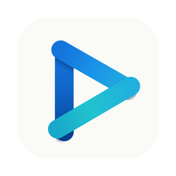

<h1 align="center">Riptide</h1>

For macOS and Apple TV

Native macOS and tvOS app that streams your Real-Debrid library with an embedded
mpv player (MKV, every codec) — a personal Infuse replacement.

Browse your debrid torrents as a poster library, match them against TMDB
metadata, play anything mpv can decode, and sync watch progress with Trakt.

## Requirements

- macOS 26+ (or Apple TV 4K on tvOS 18+, see [Apple TV](#apple-tv))
- Real-Debrid premium account + [API token](https://real-debrid.com/apitoken)
- Free [TMDB API Read Access Token](https://www.themoviedb.org/settings/api) (posters/metadata)
- Optional: [AllDebrid API key](https://alldebrid.com/apikeys) as a backup resolver
- Optional: free [OpenSubtitles API key](https://www.opensubtitles.com/en/consumers)
- Optional: a [Trakt API app](https://trakt.tv/oauth/applications) for watch-history sync

Every key is entered in Settings and stored only in the macOS Keychain.

## Install

Download the latest signed and notarized `.dmg` from
[Releases](https://github.com/sshahzaiib/riptide/releases), drag Riptide
to Applications, and launch. First launch opens Settings — paste your keys,
hit refresh, and your library appears as posters. Click to stream.

## Build from source

    swift build          # StreamCore + RiptideApp
    swift test           # StreamCore unit tests
    scripts/run.sh       # build, sign with a stable dev identity, launch

Use `scripts/run.sh` rather than `swift run RiptideApp`: an ad-hoc signed
binary changes its signature every rebuild, so macOS re-prompts for Keychain
access each launch.

## Apple TV

Riptide is now available on Apple TV. The tvOS app, `RiptideTV`, shares the
library, player and sync code with the Mac app: poster library, mpv playback,
Skip Intro, Up Next countdown and Trakt sync. It is installed through Xcode,
not the App Store (the release `.dmg` is the Mac app only).

### Requirements

- Apple TV 4K on tvOS 18+
- Xcode 27
- A paid Apple developer account if you want installs that last a year (a
  free account works, but the install expires after 7 days)
- The same Real-Debrid and TMDB keys as the Mac app

### Install

    brew install xcodegen
    scripts/run-tv.sh    # simulator: generate project, build, launch

For a real Apple TV:

    export RIPTIDE_TV_TEAM=<your team id>
    cd RiptideTV && xcodegen generate && open RiptideTV.xcodeproj

Select your Apple TV as the run destination and hit Run.

### First-run setup

1. **Pair** - the TV shows a QR code and a URL for a setup page you open on your phone.
2. **Trakt** - sign in with a device code, or skip.
3. **Done** - your library loads.

Settings has "Set up from another device" to reopen the pairing page later.

### The pairing page

Typing API keys with a remote is miserable, so the TV serves a small form
that you fill in from your phone. Real-Debrid, TMDB and the optional keys
go in there and are saved to the Apple TV's Keychain.

The setup page is served over plain HTTP on your local network. Your keys travel unencrypted between your phone and the Apple TV for the few seconds it takes to submit the form. HTTPS would require a self-signed certificate and a browser warning on every device, which we judged worse for users than this risk. The page only exists while the setup screen is open, lives at a random one-time address, and nothing else in the app ever listens on the network.

### Why Trakt is strongly recommended

tvOS may purge an app's local data when the device is short on storage.
Trakt is the source of truth for watch progress: without it, Continue
Watching is forgotten whenever tvOS clears storage, and it never matches
what you watched on the Mac.

### What the TV app does not do

- No downloads.
- No backup or restore.
- No AllDebrid-only setups - Real-Debrid and TMDB are required, same as the Mac.

## What Riptide is and is not

Riptide is a player for files that already sit in **your own** debrid
account. It hosts nothing, indexes nothing, and ships with no content
sources. You are responsible for what you add to your account and for
complying with the terms of the services you connect.

## Support

Riptide is free and GPL-licensed. If it replaced a paid player for you,
[Ko-fi](https://ko-fi.com/sshahzaiib) keeps it shipping.

## Attribution

- This product uses the TMDB API but is not endorsed or certified by TMDB.
- Riptide uses Trakt but is not endorsed or certified by Trakt.
- Subtitles via [OpenSubtitles](https://www.opensubtitles.com).
- Playback via [mpv](https://mpv.io) through
  [MPVKit](https://github.com/mpvkit/MPVKit) (LGPL build, dynamically
  linked). Do not switch the dependency to the `MPVKit-GPL` product.

## License

[GPL-3.0](LICENSE). Copyright © 2026 Shahzaib Muhammad Akram.
